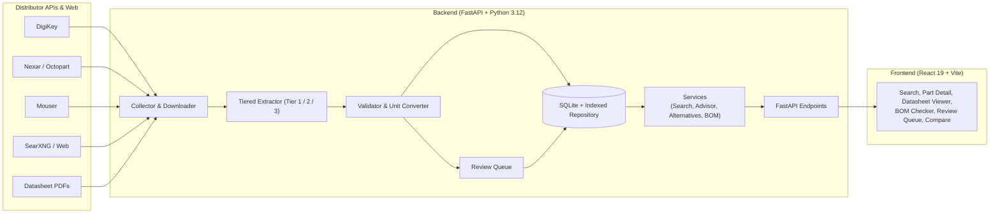

# PartPilot

> AI-assisted parametric component data mining, datasheet provenance verification, and Bill-of-Materials risk analysis for power electronics.

PartPilot ingests electronic component datasheets, extracts critical electrical specifications across a tiered pipeline (heuristics, LLM, and vision), validates extracted values with unit-normalization, and anchors every specification to its exact datasheet page provenance.

---

## Key Features

- **Natural-Language Parametric Search**: Query components using conversational specs (e.g., *"100V N-channel MOSFET, Rds(on) below 5mΩ, in stock"*) with real-time streaming, automated filter compilation, and live supplier discovery.
- **Datasheet Provenance & In-Site Viewer**: View manufacturer datasheets directly in the site with interactive page zoom, side-by-side spec highlights, and bounding-box provenance for every extracted value.
- **3-Tier Progressive Extraction**:
  - **Tier 1**: Deterministic table parsing, regex extraction, and canonical name mapping.
  - **Tier 2**: Structured LLM extraction with strict JSON schemas.
  - **Tier 3**: Multimodal vision extraction for complex scanned tables and curves.
- **Validation & Physical Sanity Checks**: Automated unit conversions via `pint`, parameter bounds checking, supplier cross-validation, and confidence scoring.
- **Smart Alternative Finder**: Suggests drop-in and functional component replacements ranked by electrical compatibility, pinout matching, and inventory health.
- **BOM Health & Risk Audit**: Upload Bill-of-Materials CSVs (KiCad, Altium, standard) to audit lifecycle obsolescence (NRND/Obsolete), supply risks, and footprint compatibility.
- **Human-in-the-Loop Review Queue**: Triage and correct low-confidence extractions with AI trade-off analysis before committing to the database.

---

## Architecture



---

## Tech Stack

- **Backend**: Python 3.12, FastAPI, SQLAlchemy, LangChain, Pydantic v2, PyMuPDF, Pint
- **Frontend**: React 19, TypeScript, Vite, Tailwind CSS, TanStack Query, Radix UI, Lucide
- **Storage & Search**: SQLite, SearXNG
- **External APIs**: DigiKey API v4, Nexar GraphQL, Mouser API

---

## Getting Started

### Prerequisites

- Python 3.12+ and [`uv`](https://docs.astral.sh/uv/) (or standard venv)
- Node.js 20+ and `npm`
- (Optional) Docker & Docker Compose

### Quick Start (Local)

1. **Clone the repository & setup environment:**
   ```bash
   git clone https://github.com/UltraInstinct21/partpilot.git
   cd partpilot
   cp .env.example .env
   ```

2. **Run with Make:**
   ```bash
   make setup       # Install backend and frontend dependencies
   make run-api     # Start FastAPI server on http://localhost:8000
   make run-web     # Start Vite frontend on http://localhost:5173
   ```

3. **Or run with Docker Compose:**
   ```bash
   docker compose up --build
   ```
   - Frontend: `http://localhost:5173`
   - API & Docs: `http://localhost:8000/docs`

---

## Configuration

Set API credentials in `.env` as needed:

```bash
# Distributor Credentials (Optional for live enrichment)
PARTPILOT_DIGIKEY_CLIENT_ID=
PARTPILOT_DIGIKEY_CLIENT_SECRET=
PARTPILOT_NEXAR_CLIENT_ID=
PARTPILOT_NEXAR_CLIENT_SECRET=
PARTPILOT_MOUSER_API_KEY=

# LLM Provider (openai, anthropic, or google)
PARTPILOT_LLM_PROVIDER=openai
OPENAI_API_KEY=your-key

# Compatible OpenAI Gateways / Local Models
# PARTPILOT_LLM_BASE_URL=http://localhost:1337/v1
# PARTPILOT_LLM_MODEL=deepseek-chat
```

*Note: PartPilot includes offline fixture mocks and deterministic fallbacks, allowing full functionality without third-party API keys.*

---

## Testing

```bash
# Backend test suite (880 tests)
./backend/.venv/bin/pytest backend/tests eval/tests

# Frontend test suite
npm --prefix frontend test -- --run
```

---

## License

MIT License. See [docs/ETHICS.md](docs/ETHICS.md) for data usage policies.
