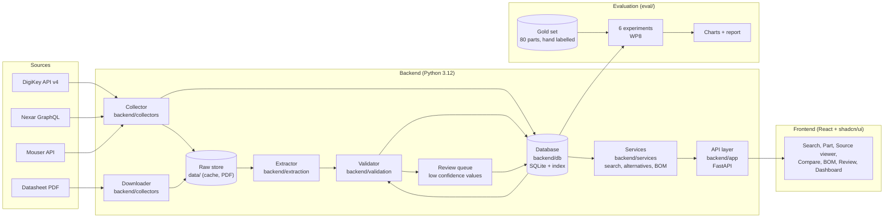

# PartPilot

**AI-assisted component data mining for power MOSFETs and gate drivers.**

PartPilot reads the datasheet of a part, extracts the numbers that an
engineer needs, checks every number, keeps the source of every number, and
lets the user search the data in plain language.

The project is the mini project of the Web Data Mining course (R5CO4201T).
**It is for study only.** Read `docs/ETHICS.md` before you use any data of
this project.

---

## What PartPilot does

1. **Collects** the part data from the official APIs of DigiKey, Nexar
   (Octopart) and Mouser.
2. **Downloads** the datasheet PDF that the API gives, with a check of
   `robots.txt`, a 1 s delay and a clear User-Agent.
3. **Extracts** the values in three tiers: a table parser and regular
   expressions (tier 1), a language model with a JSON schema (tier 2), and a
   vision model on the page image (tier 3). A higher tier is called only when
   the lower tier fails.
4. **Validates** every value: the unit is converted, the range of the field
   is checked, the value is compared with the API value, and a confidence and
   a status are computed.
5. **Stores** the value with its source, its page, its tier, its condition,
   its confidence and its status.
6. **Serves** the data through a FastAPI API and a React frontend: a
   natural-language search, a part page with the datasheet page next to each
   value, a review queue, an alternative finder, a BOM health check and a
   dashboard.

## Architecture



The data moves through nine modules in this order: collector, raw store,
extractor, validator, database, services, API layer, review queue,
frontend.

## The folder layout

```text
partpilot/
  backend/
    app/            FastAPI routes and the wiring of the services
    collectors/     DigiKey, Nexar and Mouser clients, the PDF downloader
    db/             the SQLAlchemy models, the repository and the seed
    extraction/     tier1 (parser), tier2 and tier3 (LangChain chains)
    services/       search, alternatives, BOM check, review, stats
    shared/         the frozen contracts: schemas, interfaces, config
    tests/          the tests of the backend
    tools/          the mock API
  frontend/
    src/            the React application and the shadcn/ui components
  contracts/       the OpenAPI contract and the recorded fixtures
  data/            the raw PDFs, the cache and the database (not in Git)
  eval/            the gold set, the metrics, the six experiments, the charts
  docs/            the plan, the contracts, the ethics note, the report
  docker/          the images of the backend and of the frontend
  .github/         the CI workflows
  Makefile         the task runner
```

## Run it

Every command works from a clean checkout after `make setup`.

| Command | What it does |
| --- | --- |
| `make setup` | Install the backend and the frontend dependencies. |
| `make run-api` | Start the FastAPI backend on <http://127.0.0.1:8000>. |
| `make run-web` | Start the Vite frontend on <http://127.0.0.1:5173>. |
| `make mock-api` | Start the fixture backed mock API on <http://127.0.0.1:8001>. |
| `make test` | Run the backend pytest suite and the frontend vitest suite. |
| `make lint` | Run ruff, black, eslint and prettier. |

The evaluation package has its own commands:

```bash
cd backend
.venv/bin/python -m eval --help              # the list of the commands
.venv/bin/python -m eval validate-gold ../eval/gold_set.csv
.venv/bin/python -m eval agreement ../eval/gold_set.csv
.venv/bin/python -m eval queries             # the 30 test queries
.venv/bin/python -m eval demo                # the six experiments on the fixtures
.venv/bin/python -m eval charts ../eval/results/demo_results.json
```

The tests of the evaluation package live at the root of the repository:

```bash
cd backend && .venv/bin/python -m pytest ../eval -q
```

### With Docker

```bash
cp .env.example .env      # fill in the keys, or leave them empty for the demo
docker compose up --build                  # the API on :8000, the web on :5173
docker compose --profile mock up mock-api  # the mock on :8001
docker compose down
```

The images hold no secret. The keys come from the `.env` file of the server.
The `data/` folder is a volume, so the PDFs and the database survive a
restart.

## The API keys

The keys stay on the server. They are never in Git, never in the browser and
never in a prompt of the language model (NFR-02, NFR-07).

```bash
cp .env.example .env
```

| Key | Where to get it | What it opens |
| --- | --- | --- |
| `PARTPILOT_DIGIKEY_CLIENT_ID` and `PARTPILOT_DIGIKEY_CLIENT_SECRET` | <https://developer.digikey.com> - register an application and create an organisation when the portal asks for one. | The product details, the prices, the stock, the lifecycle and the datasheet links. |
| `PARTPILOT_NEXAR_CLIENT_ID` and `PARTPILOT_NEXAR_CLIENT_SECRET` | <https://portal.nexar.com> - create an application and request the `supply` scope. | Provider-first discovery: stock, lifecycle, datasheet links, and candidate similar parts. |
| `PARTPILOT_MOUSER_API_KEY` | <https://www.mouser.com/api-search/> - request a Search API key. | The second price and stock source, and the cross-check of the values. |
| `OPENAI_API_KEY` (or `ANTHROPIC_API_KEY`, or `GOOGLE_API_KEY`) | The portal of the provider that you choose in `PARTPILOT_LLM_PROVIDER`. | The tier 2 and tier 3 extraction, the name mapping, the filter builder and the explanation of the alternatives. |

### Any OpenAI compatible endpoint

The LangChain **OpenAI** provider works with every OpenAI compatible gateway.
To use one - for example OpenCode Zen, which serves free models - set three
more values in `.env`:

```bash
PARTPILOT_LLM_PROVIDER=openai
PARTPILOT_LLM_BASE_URL=http://127.0.0.1:1337/v1
PARTPILOT_LLM_MODEL=moonshotai/kimi-k2.6:free
PARTPILOT_LLM_API_KEY=your-zen-key
```

`PARTPILOT_LLM_BASE_URL` and `PARTPILOT_LLM_API_KEY` are optional. Leave them
empty and the provider uses its own default URL and the key from its own
environment variable. `PARTPILOT_LLM_VISION_BASE_URL` points tier 3 at
another endpoint when the vision model lives elsewhere.

When the endpoint cannot be reached, the search still works: the query is
parsed by a deterministic fallback that only builds a filter. The database
always chooses the rows.

The values of `.env.example` are the safe defaults: no key, the rate limits
below the documented limits, the delay of 1 s and the User-Agent with a
contact address. **Change the contact address to the address of your team
before a real run.**

The documented limits are in `docs/ETHICS.md`:

| Service | Limit |
| --- | --- |
| DigiKey | 120 requests per minute, 1000 requests per day |
| Mouser | 30 requests per minute, 1000 requests per day |
| Nexar | 1000 parts per month on the free plan |
| Every host | 1 second between two requests |

## The requirements and the code that covers them

### Functional requirements

| ID | Requirement | Where it is implemented |
| --- | --- | --- |
| FR-01 | Collect part data from at least two APIs. | `backend/collectors/` (DigiKey, Nexar, Mouser), `backend/collectors/bundle.py` |
| FR-02 | Download the datasheet PDFs from the links of the API data. | `backend/collectors/downloader.py` (robots.txt, delay, PDF check, hash) |
| FR-03 | Extract at least 12 fields for each MOSFET. | `backend/extraction/tier1/`, `backend/extraction/llm/`, `shared/schemas.py:MosfetSpec` (13 fields) |
| FR-04 | Extract at least 10 fields for each gate driver. | `backend/extraction/tier1/`, `backend/extraction/llm/`, `shared/schemas.py:GateDriverSpec` (13 fields) |
| FR-05 | Save the condition with each value. | `backend/shared/schemas.py:ParameterValue.condition`, the extractor and the LLM prompts |
| FR-06 | Convert all values to standard units. | `backend/validation/` (`pint`), `backend/shared/config.py` |
| FR-07 | Reject a value that is outside the allowed range. | `backend/validation/` (the range rules and the status) |
| FR-08 | Compare each extracted value with the API value. | `backend/validation/` (the cross-check), `backend/services/stats.py` |
| FR-09 | Save the source file, the page and the confidence of each value. | `backend/db/` (`parameters` table), `backend/shared/schemas.py:SourceRef` |
| FR-10 | Send the low-confidence values to a review list. | `backend/services/review.py`, `backend/app/` (`GET /api/review`) |
| FR-11 | Search in plain language. | `backend/extraction/llm/` (the filter builder), `backend/services/search.py`, `POST /api/search` |
| FR-12 | Show the datasheet page next to each value. | `backend/app/` (`GET /api/sources/{source_id}/page/{n}`), `frontend/src/` (the source viewer) |
| FR-13 | Give a ranked list of alternative parts. | `backend/services/alternatives.py`, `GET /api/parts/{id}/alternatives` |
| FR-14 | Accept a BOM file and flag the risk. | `backend/services/bom.py`, `POST /api/bom/check` |
| FR-15 | Show the status of each part (active, NRND, obsolete). | `backend/collectors/` (the lifecycle), `backend/shared/schemas.py:LifecycleStatus`, the part page |

Provider-first discovery is part of FR-11/FR-13: a live search queries the
configured distributor providers and web scrapers, merges their normalized
records with the indexed catalogue, and ranks the combined set for the
requested use case. The indexed catalogue is a cache and fallback, not the
only source of candidates.

### Non-functional requirements

| ID | Requirement | Where it is implemented |
| --- | --- | --- |
| NFR-01 | Obey the rate limit of every API. | `backend/shared/config.py`, the rate limiter of every collector, `docs/ETHICS.md` |
| NFR-02 | The keys stay on the server. | `backend/shared/config.py`, `.env` (not in Git), the frontend never holds a key |
| NFR-03 | The LLM must not create a value that is not in the source. | The prompt rules of `backend/extraction/llm/`, the failed fields, `backend/validation/` |
| NFR-04 | A search answers in 5 seconds or less. | `backend/services/search.py`, the cache of the LLM, the measurement in `eval/metrics.py:latency_stats` |
| NFR-05 | The extraction of one datasheet costs less than the budget. | The tiered use in `backend/extraction/`, `llm_calls` table, `eval/metrics.py:cost_per_datasheet` |
| NFR-06 | The code has a README and tests. | This file, `backend/tests/`, `eval/tests/`, `frontend/tests/` |
| NFR-07 | The frontend never calls a distributor API or an LLM. | The frontend calls only `/api/*`; `docker/nginx.conf` proxies `/api` to the backend |

## The demo

The full script is in `docs/DEMO.md`. The six steps of the demo are:

1. **Search**: type `100 V N-channel MOSFET, Rds(on) below 5 mOhm, in stock`.
   Show the filter chips and the result table.
2. **Show a value**: click the value of `Rds(on)`. Show the unit, the
   condition, the confidence badge and the datasheet page in the side panel.
3. **Show a rejected value**: open the review queue and show a value that
   the validator stopped, with the reason.
4. **Show the alternatives**: open the alternatives of an obsolete part and
   show the ranking with the reason.
5. **Upload a BOM**: upload `docs/demo_bom.csv` and show the risk table.
6. **Show the evaluation**: run `python -m eval demo` and show the charts of
   `eval/results/`.

Run the demo on a local machine. Keep a screen recording as a backup. Test
the whole demo the day before.

## The evaluation

The harness is in `eval/`. It measures the system with a gold set that a
person labelled by hand.

* `eval/metrics.py` - the metric functions. Each one is pure.
* `eval/gold_set.py` - the loader, the validator and the agreement report.
* `eval/runners.py` - the six experiments of plan WP8.
* `eval/queries.py` - the 30 natural-language search queries.
* `eval/charts.py` - the five charts.
* `eval/gold_set_template.csv` - the format of the gold set.

How to build the gold set of 80 parts is in `docs/GOLD_SET.md`.

## The known gaps and what needs a human

| Gap | What is needed |
| --- | --- |
| The API keys | Three accounts: DigiKey, Nexar and Mouser. Fill in `.env`. |
| The gold set | 80 parts, 5 manufacturers, 10 to 15 fields each, and a second member that checks 20 % of the labels. `docs/GOLD_SET.md` has the method. |
| The real datasheets | The download of the PDFs of the seed parts. They stay in `data/`, never in Git. |
| The report | The numbers of the real run of the six experiments, the failure analysis and the references. `docs/REPORT.md` is the skeleton. |
| The contact address | The User-Agent holds an example address. Change it in `.env`. |
| `matplotlib` | The charts need the package. It is not in `backend/pyproject.toml` yet: `docs/CHANGE_REQUESTS/i-eval-docs-1.md`. |

## The documents

| File | Content |
| --- | --- |
| `docs/PLAN.md` | The end-to-end project plan. |
| `docs/CONTRACTS.md` | The frozen contract layer: the schemas, the interfaces, the endpoints, the limits. |
| `docs/ETHICS.md` | The ethics note. |
| `docs/GOLD_SET.md` | How to build the gold set. |
| `docs/REPORT.md` | The skeleton of the report. |
| `docs/DEMO.md` | The demo script. |
| `docs/HANDOFF.md` | What the evaluation and the documents deliver, and what is open. |

## The licence

MIT for the code of this repository. The data belongs to its owners. See
`docs/ETHICS.md`.
